 
 

 
 

 
 

 
 

 
 

<!--
  The panels are generated:
    python scripts/build_profile.py      -> edit PROFILE at the top of that file
    contrib-heatmap.svg is refreshed daily by .github/workflows/update-profile.yml
-->
